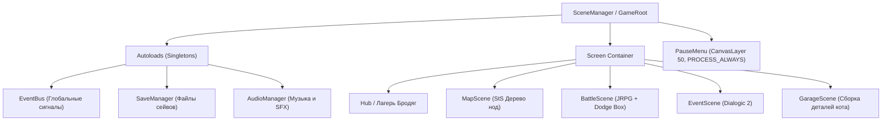
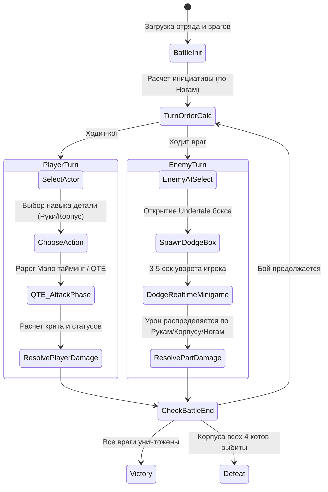

# ADR-001: Архитектурный дизайн проекта «Xenocats: Аварийная частота Бремен-4»

* **Статус:** Принято (Accepted)
* **Версия движка:** Godot 4.7.2 (Stable)
* **Язык разработки:** GDScript (со строгой статической типизацией)
* **Жанр:** Рогалик с JRPG-боями, тайм-элементами защиты/атаки, модульной сборкой робо-котов (Front Mission) и нарративными ивентами (Dialogic 2).

---

## 1. Контекст и цели (Context)

Проект представляет собой коммерчески ориентированный 2D-рогалик с партийными пошаговыми боями в сеттинге кибер-свалки с участием механических котов («Бременские музыканты»). 

### Ключевые геймплейные опоры:
1. **Мета-карта забега (DAG)** в стиле *Slay the Spire* (ветвящиеся пути, выбор между боями, мастерскими, событиями).
2. **Партийная JRPG-боёвка 4vX** с фирменной механикой «Пирамида Бремена» (стыковка всех 4 котов в одного меха-титана на 1 раунд).
3. **Модульная система мехов (Front Mission style)**: у каждого кота ровно **3 детали** (Корпус, Ноги, Руки), у каждой детали — **собственная полоска HP**, вес и способности.
4. **Гибридный реалтайм в бою**:
   * *Атака:* QTE / тайминг-шкалы (*Paper Mario*) для критических ударов и комбо.
   * *Защита:* мини-игра с уклонением от снарядов в боксе (*Undertale*), где попадания распределяются по деталям (Руки/Корпус/Ноги) в зависимости от точки контакта или типа угрозы.
5. **Нарратив и VN-события**: текстовые встречи на нодах и кат-сцены через **Dialogic 2**.
6. **Сохранения**: сохранение прогресса между нодами карты + глобальный файл мета-прогрессии в Хабе. Внутри боевой сцены сохранение не требуется.

---

## 2. Архитектурные решения (Decisions)

### 2.1. Версия движка и конфигурация рендера (Display & Pixel-Art)
* **Движок:** `Godot 4.7.2.stable.official.win64`.
* **Базовое разрешение (Viewport):** `640 × 360` (16:9, кратно 720p, 1080p, 1440p, 4K без размытия).
* **Stretch Mode:** `viewport`, **Stretch Aspect:** `keep`.
* **Pixel Snapping:** Включены параметры `rendering/2d/snap/snap_2d_transforms_to_pixel` и `rendering/2d/snap/snap_2d_vertices_to_pixel` для устранения джиттера субпиксельных артефактов.
* **Текстуры:** Текстурный фильтр по умолчанию: `Nearest` (Point).

---

### 2.2. Стандарты кода и языка (GDScript Styleguide)
* Строгая статическая типизация (`typed_gdscript`):
  * Все переменные объявляются с типом (`var current_hp: int = 100`, `var target: BattleUnit = null`).
  * Все функции имеют строгие сигнатуры аргументов и возвращаемых типов (`func calculate_damage(attacker: BattleUnit) -> DamageResult:`).
  * Предупреждения компилятора (`untyped_declaration`) настроены как `Warning` или `Error`.
* Парадигма **Data-Driven (на базе `Resource`)**:
  * Никаких «захардкоженных» статов в скриптах. Все детали, навыки, мобы, диалоги и перки оформляются как кастомные `.tres` файлы.

---

### 2.3. Топология сцен и менеджмент состояния (Global Architecture)



#### Политика `Autoload` (Синглтонов) и паузы
Минимизировать количество Autoload до трёх критических сервисов:
1. `EventBus`: Шина слабосвязанных событий (например: `cat_part_destroyed(cat_id, part_slot)`, `node_selected(node_id)`, `sync_gauge_filled()`).
2. `SaveManager`: Сериализация/десериализация состояния забега (`RunState`), мета-прогресса хаба (`MetaState`) и пользовательских настроек (`GameSettings`).
3. `AudioManager`: Управление треками, аварийными кассетами (*Music Tapes*) и микшером (`Master`, `Music`, `SFX`), а также приглушением музыки (LowPass + Amplify) на паузе.

*Все остальные подсистемы инкапсулируются внутри соответствующих сцен (`PauseMenu` в `GameRoot`, `SettingsPanel`, `TutorialOverlay` и `TutorialToast` в `src/ui/`). При постановке дерева на паузу (`get_tree().paused = true`) режим `PROCESS_MODE_ALWAYS` разрешён только для `AudioManager` и модальных UI-оверлеев; все боевые таймеры создаются с `process_always = false`.*

---

### 2.4. Боевая подсистема (Combat Architecture)

Боевая сцена реализуется через **State Machine (Конечный автомат)** с четким разделением логики и анимации.



#### Модульность мехов (Front Mission 3-Part Model):
Каждый персонаж отряда описывается сущностью `CatMechInstance`, содержащей 3 слота:

```gdscript
class_name CatMechInstance
extends RefCounted

var cat_id: StringName # "FELIX", "MULE", "HOUND", "COCK"
var body_part: PartInstance   # Корпус (Core / Body)
var arms_part: PartInstance   # Руки / Орудия (Arms)
var legs_part: PartInstance   # Ноги / Шасси (Legs)

# Состояние
func is_alive() -> bool:
    return body_part.current_hp > 0

func get_initiative_score() -> int:
    if legs_part.is_broken():
        return int(legs_part.base_speed * 0.3) # Штраф 70% скорости при сломанных ногах
    return legs_part.base_speed
```

* **Правила уничтожения деталей:**
  * **Руки (Arms):** При `HP == 0` блокируются атакующие скиллы этой детали, кот может использовать только базовый слабый аварийный тычок.
  * **Ноги (Legs):** При `HP == 0` инициатива кота падает на дно очереди, а в мини-игре защиты скорость движения аватара падает на 40%.
  * **Корпус (Body):** При `HP == 0` юнит полностью выбывает из боя (KO).
  * **Механика «Пирамида» (Стыковка):** Все уцелевшие детали 4 котов складывают суммарный пул мощности и HP, создавая гигантского меха-тотема на 1 раунд.

#### Реализация Dodge Box (Undertale-style):
* Отдельный узел `DodgeArena` (Control + 2D Viewport).
* Аватар игрока (сердечко/ядро кота) имеет 3 сегментных коллайдера:
  * **Верхний сектор:** попадание засчитывает урон в `Arms`.
  * **Центральный сектор:** урон в `Body`.
  * **Нижний сектор:** урон в `Legs` (при уничтожении снижает скорость перемещения аватара на 40%).
* **Уникальные паттерны боссов и элиток (Issue #10):**
  * **Трёхголовый пресс:** мощные вертикальные молоты с предупреждающими линиями телеграфа + осколки от удара по нижней зоне (Legs).
  * **Атаманша:** сканирующий лазерный прицел турели крана + вращающиеся расширяющиеся лазерные лучи.
  * **Спящий спутник:** орбитальная бомбардировка с прицельными ретикулами, самонаводящиеся радио-сферы и фазовые помехи.
* **Предупреждающие маркеры (Telegraphing):**
  * Кратковременные полупрозрачные красные зоны предупреждения (колонны `rect`, линии прицеливания `line`, ретикулы наведения `circle`) с динамической пульсацией перед залпами мощных снарядов.
* **Модульность паттернов (Multi-Wave Sequencer):**
  * Возможность привязывать к одной атаке босса комбинацию нескольких волн снарядов (`dodge_patterns: Array[StringName]` на уровне навыка или врага) либо одновременное наложение нескольких типов снарядов (`+`).

---

### 2.5. Структура данных (Data Model / Resources)

Все конфигурации разделены на неизменяемые чертежи (Blueprints via `Resource`) и динамические состояния инстансов (`RuntimeState`):

* `res://data/resources/parts/`:
  * `PartData.gd` (`part_id`, `slot: PartSlot`, `max_hp`, `armor`, `skills: Array[SkillData]`, `sprite_frames`).
* `res://data/resources/skills/`:
  * `SkillData.gd` (`skill_name`, `target_type`, `base_damage`, `status_effects`, `qte_profile`, `dodge_pattern_id`, `dodge_patterns: Array[StringName]`).
* `res://data/resources/enemies/`:
  * `EnemyData.gd` (`enemy_name`, `parts`, `ai_pattern`, `dodge_pattern_id`, `dodge_patterns: Array[StringName]`).
* `res://data/resources/music_tapes/`:
  * `MusicTapeData.gd` (`tape_id`, `track_stream`, `passive_aura_effect`).
* `res://data/resources/tutorials/`:
  * `TutorialData.gd` (`tutorial_id`, `title`, `body`, `order`, `presentation: MODAL | TOAST`, `toast_duration`).

---

### 2.6. Мета-карта забега (StS DAG Graph)
* Карта генерируется алгоритмически в виде направленного ациклического графа (DAG) на 15 этажей для каждого из 3 секторов.
* Генератор использует псевдослучайный сид (`run_seed`), гарантирующий воспроизводимость.
* Типы нод:
  * `Combat` (Обычный бой с мародерами)
  * `Elite` (Усиленный дроид с гарантированным дропом редкой детали)
  * `Workshop / Scrap` (Ремонт деталей, пересборка мехов)
  * `Event / Transmission` (Диалоговое событие на базе Dialogic 2)
  * `Boss` (Финал сектора: Пресс, Атаманша, Спутник)

---

### 2.7. Нарратив и диалоги (Dialogic 2)
* Для всех сюжетных включений и текстовых выборов в нодах используется **Dialogic 2**.
* Интеграция с кодом игры:
  * Диалог может отправлять кастомные сигналы в `EventBus` (например, выдать ресурс `Titanium Scrap` или повредить деталь коту в результате взрыва).
  * Поддержка портретов для 4 котов с эмоциями (глючащий экран, дым, боевой оскал).

---

### 2.8. Архитектура сохранений (Persistence)
* **Файл мета-прогресса:** `user://meta_save.json`
  * Открытые перки в древе навыков Хаба.
  * Количество `Titanium Scrap` и `AI Cores`.
  * Разблокированные музыкальные кассеты (*Music Tapes*).
* **Файл текущего забега:** `user://current_run.json`
  * Сохраняется между нодами карты, а также на **входе в бой** (чекпоинт `pending_battle` для переигровки боя с начала или возврата из Лагеря).
  * Хранит: текущий сид, карту, индекс текущей ноды, состояние деталей партии (текущие HP и экипировка), инвентарь запчастей и `pending_battle`.
  * При гибели или удалении забега файл стирается.
* **Файл пользовательских настроек:** `user://settings.cfg`
  * Хранит громкость шин (`Master`, `Music`, `SFX`), полноэкранный режим (`fullscreen`), флаг активности обучения (`tutorials_enabled`) и список просмотренных подсказок (`seen_tutorials`). Не затрагивается при сбросе прогресса.

---

## 3. Файловая структура проекта

```text
res://
├── assets/
│   ├── sprites/          # Спрайты деталей котов, врагов, UI (пиксель-арт)
│   ├── audio/            # Музыкальные кассеты, SFX
│   └── fonts/            # Пиксельные TTF/Bitmap шрифты
├── addons/
│   └── dialogic/         # Плагин Dialogic 2
├── src/
│   ├── core/
│   │   ├── event_bus.gd
│   │   ├── save_manager.gd
│   │   ├── audio_manager.gd
│   │   └── scene_manager.gd
│   ├── models/           # Ресурсы и типы данных (PartData, CatMechInstance, GameSettings, TutorialData...)
│   ├── combat/
│   │   ├── combat_arena.gd
│   │   ├── combat_fsm.gd
│   │   ├── qte_controller.gd
│   │   └── dodge_box/    # Мини-игра уворота (Undertale box)
│   ├── map/              # Генератор и отображение StS-карты
│   ├── garage/           # Экран сборки/замены деталей кошачьих мехов
│   ├── hub/              # Лагерь Бродяг (мета-прогрессия)
│   └── ui/               # PauseMenu, SettingsPanel, TutorialOverlay, TutorialToast
└── data/                 # .tres ресурсы деталей, скиллов, врагов, кассет, обучения
```

---

## 4. Последствия (Consequences)

### Положительные:
1. **Изолированность систем**: Боевая система ничего не знает о карте; мини-игра уворота `DodgeBox` — это независимый модуль, который можно тестировать отдельно в любой тестовой сцене.
2. **Простота добавления контента**: Новые детали мехов и враги создаются через графический интерфейс инспектора Godot (новые `.tres` ресурсы) без изменения боевого движка.
3. **Безопасность сохранений**: Сохранение только между нодами предотвращает баги сериализации сложного боевого стейта.
4. **Контроль геймплейных ощущений**: Разделение урона по 3 деталям даёт глубокий тактический пласт из Front Mission, сохраняя динамику благодаря аркадным QTE и уворотам.

### Риски и смягчение (Mitigations):
* *Риск:* Сложность баланса мини-игры уворота (чтобы не было слишком душно для любителей JRPG).
  * *Смягчение:* Каждая деталь имеет броню; успешность уворота лишь снижает урон, а не делает бой бинарным («идеально увернулся или умер»).
* *Риск:* Нагрузка на спрайты 4 котов × 3 детали.
  * *Смягчение:* Модульная сборка спрайтов через отдельные `Sprite2D` узлы (Руки, Корпус, Ноги) с общими точками привязки (`Marker2D`).

