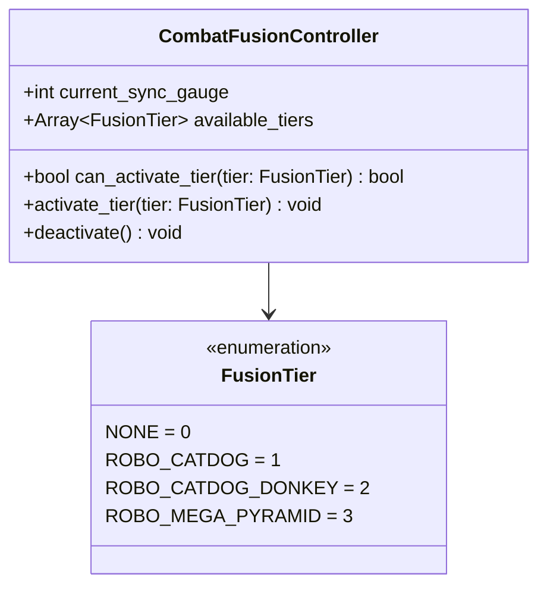
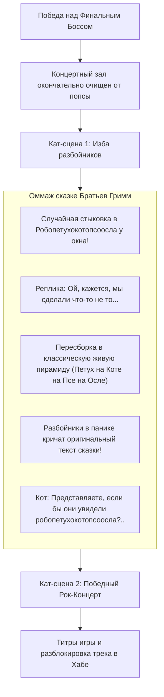

# ADR-002: Прогрессия забегов, фазовый финальный босс, динамические слияния и мета-нарратив («Пирамида Бремен-4»)

* **Статус:** Принято (Accepted)
* **Версия движка:** Godot 4.7.2 (Stable)
* **Язык разработки:** GDScript (со строгой статической типизацией)
* **Связанные документы:** [ADR-001 (Базовый архитектурный дизайн)](ADR-001-Architecture-Design-Record.md), `synopsis.txt`

---

## 1. Контекст и цели (Context & Objectives)

Настоящий ADR фиксирует принятый редизайн мета-прогрессии забегов (Run-Loop), многостадийной структуры финального босса, расширенной механики ступенчатых слияний («Пирамида»), нарративной системы мета-юмора с разрушением четвёртой стены и эпилога игры.

### Ключевые цели редизайна:
1. **Динамическая прогрессия забегов (Replayability Loop):** отказ от статического забега со всеми четырьмя персонажами с самого старта. Игрок начинает пролог в одиночку (только Кот), сталкивается с непреодолимым сюжетным барьером босса и шаг за шагом расширяет маршрут и постоянный состав отряда.
2. **Гармоничная 4-цветная система биомов и персонажей:** полное соответствие цветовой палитры отряда, биомов и фаз босса:
   * **Синий (Blue):** Кот (FELIX / Соло-гитара) $\rightarrow$ **Синий биом** (Ретранслятор Бремен-4 / Финал).
   * **Красный (Red):** Пёс (H.O.U.N.D. / Ударные) $\rightarrow$ **Красный биом** (Сектор мародёров).
   * **Жёлтый (Yellow):** Осёл (M.U.L.E. / Бас-гитара) $\rightarrow$ **Жёлтый биом** (Промзона / Гусеничные цеха).
   * **Зелёный (Green):** Петух (C.O.C.K. / Синтезатор) $\rightarrow$ **Зелёный биом** (Высотные радиовышки / Эфирный сектор).
3. **Многоуровневая система слияний (Tiered Fusions):** эволюция классической «Пирамиды» от дуэта до квартета с уникальными формами, способностями, возможностью использования в обычных боях и гибким выбором тира:
   * *Тир 1:* **Робокотопёс** (Кот + Пёс) — доступен за 50% шкалы Гармонии.
   * *Тир 2:* **Робокотопсоосёл** (Кот + Пёс + Осёл) — доступен за 75% шкалы.
   * *Тир 3:* **Робопетухокотопсоосёл** (Кот + Пёс + Осёл + Петух / «Мега-Пирамида») — доступен за 100% шкалы.
4. **Освобождение напарников через боссов биомов:** Осёл и Петух освобождаются в качестве сюжетной награды после победы над уникальными боссами соответствующих биомов.
5. **4-фазный финальный босс с механикой цветовой уязвимости:** босс имеет части четырёх цветов, соответствующих героям. Урон по сегменту цвета наносит только соответствующий персонаж (или его компонент в слиянии). Переход между фазами блокируется требованием активации соответствующего тира слияния.
6. **Фейковый босс «Заслуженные деятели эстрады»:** ненавистная попса в блёстках, фонограмме и кибер-протезах, оккупировавшая концертный зал, которая при виде истинного рока паникует и сбегает.
7. **Нарративный мета-юмор (Dialogic 2 + 4th Wall Break):** сквозной гэг про «робо-писикота», КВН 30-летней давности, скуфов в Стиме, интерактивный диалог со сломом четвёртой стены и специфический лорный позывной C.O.C.K.
8. **Финал и классический оммаж сказке:** конвейер финальных кат-сцен с «ошибочным» слиянием перед окном избы разбойников, классической пирамидой животных и триумфальным рок-концертом.

---

## 2. Архитектурные решения (Decisions)

### 2.1. Мета-петля забегов и топология 4 спектральных биомов (Run Progression Topology)

Принята схема **линейного наращивания длины забега (Вариант А)** в обратной перспективе: Кот изначально находится в своём родном Синем биоме у радиовышки, но после поражения отбрасывается всё дальше на окраины планеты, собирая союзников и пробиваясь обратно к вершине.

```mermaid
stateDiagram-v2
    [*] --> Run0_Solo: Забег 0 (Пролог)
    
    state Run0_Solo {
        Cat_Alone --> BlueBiome_Short: Синий биом (легкий проход)
        BlueBiome_Short --> Boss_Phase1_Win: Победа над Фазой 1 (Синяя часть)
        Boss_Phase1_Win --> Boss_Immune_0Dmg: Урон = 0! "Музыка слишком слабая!"
        Boss_Immune_0Dmg --> Hub_Ejection: Катапультирование на свалку Красного биома
    }

    Run0_Solo --> Run1_Duo: Встреча Пса (H.O.U.N.D.)
    
    state Run1_Duo {
        Duo_Start --> RedBiome: Красный биом (Сектор мародёров)
        RedBiome --> BlueBiome_R1: Синий биом (Ретранслятор)
        BlueBiome_R1 --> Fusion_CatDog: Слияние в Робокотопса!
        Fusion_CatDog --> Boss_YellowImmune: Отрастает Жёлтая часть (Урон = 0)
        Boss_YellowImmune --> Hub_Ejection_R1: "Одними гитарами и барабаном не удивить!"
    }

    Run1_Duo --> Run2_Trio: Открытие Жёлтого биома
    
    state Run2_Trio {
        Trio_Start --> YellowBiome: Жёлтый биом (Промзона)
        YellowBiome --> Boss_Yellow_Defeated: Босс побежден -> Освобожден Осёл (M.U.L.E.)!
        Boss_Yellow_Defeated --> RedBiome_R2: Красный биом
        RedBiome_R2 --> BlueBiome_R2: Синий биом
        BlueBiome_R2 --> Fusion_CatDogDonkey: Слияние в Робокотопсоосла!
        Fusion_CatDogDonkey --> Boss_GreenImmune: Отрастает Зелёная часть (Урон = 0)
    }

    Run2_Trio --> Run3_Quartet: Открытие Зелёного биома
    
    state Run3_Quartet {
        Quartet_Start --> GreenBiome: Зелёный биом (Радиовышки)
        GreenBiome --> Boss_Green_Defeated: Босс побежден -> Освобожден Петух (C.O.C.K.)!
        Boss_Green_Defeated --> YellowBiome_R3: Жёлтый биом
        YellowBiome_R3 --> RedBiome_R3: Красный биом
        RedBiome_R3 --> BlueBiome_R3: Синий биом (Концертный зал)
        BlueBiome_R3 --> FakeBoss_PopStars: Фейковый босс "Заслуженные деятели эстрады"
        FakeBoss_PopStars --> FinalBoss_4Phases: Истинный финальный босс (4 Фазы)
        FinalBoss_4Phases --> MegaPyramid_Finisher: Полный квартет и Финальный аккорд!
    }
    
    MegaPyramid_Finisher --> Epilogue_Cabin: Изба разбойников
    Epilogue_Cabin --> Epilogue_Concert: Финальный Концерт
    Epilogue_Concert --> [*]
```



#### Структура сюжетных циклов:
1. **Забег 0 (Пролог):**
   * *Отряд:* Только FELIX (Кот, Синий цвет).
   * *Маршрут:* Только **Синий биом** (сокращённый). Враги простые, Кот легко проходит локацию и удивляется, почему прослушивание называют сложным.
   * *Финал:* Фаза 1 босса (Синий сектор) повержена. Затем босс блокирует дальнейший урон (`0` урона): *«Музыка слишком слабая. Прослушивание не пройдено!»* и катапультирует Кота на дальнюю свалку.
2. **Забег 1 (Дуэт):**
   * *Отряд:* FELIX + H.O.U.N.D. (Кот + Пёс).
   * *Маршрут:* **Красный биом $\rightarrow$ Синий биом**.
   * *Финал:* При победе над Фазой 1 Гармония достигает 100%, запускается слияние в **Робокотопса**. Босс отращивает **Жёлтую часть** (уязвимость Осла), по которой наносится `0` урона. Босс: *«Одними гитарами и барабаном меня не удивить!»*.
3. **Забег 2 (Трио):**
   * *Отряд:* FELIX + H.O.U.N.D., в конце первого биома освобождается M.U.L.E.
   * *Маршрут:* **Жёлтый биом $\rightarrow$ Красный биом $\rightarrow$ Синий биом**.
   * *Условие спасения:* В конце Жёлтого биома побеждается его босс, освобождая **M.U.L.E. (Осёл)**.
   * *Финал:* Доступно слияние **Робокотопсоосёл**, пробивающее Жёлтую часть. Босс отращивает **Зелёную часть** (уязвимость Петуха) и вновь блокирует проход.
4. **Забег 3 (Квартет):**
   * *Отряд:* FELIX + H.O.U.N.D. + M.U.L.E., в конце первого биома освобождается C.O.C.K.
   * *Маршрут:* **Зелёный биом $\rightarrow$ Жёлтый биом $\rightarrow$ Красный биом $\rightarrow$ Синий биом**.
   * *Условие спасения:* Босс Зелёного биома повержен, освобождается **C.O.C.K. (Петух)**.
   * *Финал:* Полный маршрут через все 4 спектральных биома, пробитие всех 4 фаз, фейк-босс эстрады и истинная победа.

#### Персистентность при случайной гибели:
* Если игрок погибает от мобов или элиток посреди биома, **все разблокированные напарники остаются навсегда** в `SaveManager` (`unlocked_party_members`). Игрок начинает новый забег уже сформированным расширенным составом без отката сюжета назад.

---

### 2.2. Механика ступенчатых слияний в обычных боях и выбор тира

Механика слияния («Пирамида») полностью заменяется на систему ступенчатых робо-слияний и **доступна в любых боях** (обычные мобы, элитки, боссы).



#### Стоимость и возможности тиров:
1. **Тир 1: «Робокотопёс» (`ROBO_CATDOG`)**
   * *Требование:* В отряде есть Кот и Пёс.
   * *Стоимость шкалы Гармонии:* **50%**.
   * *Длительность:* 2 раунда.
   * *Боевой фокус:* Высокая скорость, комбо-удары, кровотечение, двойной урон по Синим и Красным уязвимостям.
2. **Тир 2: «Робокотопсоосёл» (`ROBO_CATDOG_DONKEY`)**
   * *Требование:* В отряде есть Кот, Пёс и Осёл.
   * *Стоимость шкалы Гармонии:* **75%**.
   * *Длительность:* 2 раунда.
   * *Боевой фокус:* Броня +60%, провокация атак, сейсмический урон, пробитие Синих, Красных и Жёлтых уязвимостей.
3. **Тир 3: «Робопетухокотопсоосёл / Мега-Пирамида» (`ROBO_MEGA_PYRAMID`)**
   * *Требование:* Полный квартет (все 4 героя живы).
   * *Стоимость шкалы Гармонии:* **100%**.
   * *Длительность:* 3 раунда.
   * *Боевой фокус:* Абсолютный статус-иммунитет, разрушение щитов, универсальный спектральный урон по всем 4 цветам, доступ к командному добиванию.

#### Свободный выбор тира в бою:
* Даже при наличии всех 4 персонажей в отряде игрок **не обязан копить 100%**. При заполнении 50% в боевом меню подсвечивается кнопка *«Слияние: Робокотопёс»*, при 75% — *«Слияние: Робокотопсоосёл»*, при 100% — *«Слияние: Мега-Пирамида»*. Это даёт тактическую гибкость в быстрых схватках с рядовыми мобами.

---

### 2.3. Фейковый босс «Заслуженные деятели эстрады»

Перед решающей битвой в концертном зале радиостанции «Бремен-4» в Синем биоме отряд натыкается на препятствие — зал оккупирован эстрадной мафией.

#### Образ и поведение фейк-босса:
* **Имя юнита:** *«Кибер-Примадонн / Ансамбль "Золотой Автотюн"»*.
* **Визуал:** Нелепый шагающий дроид, покрытый стразами, фальшивым хромом, перьями и динамиками, из которых доносится глухая пластмассовая попса и синтетический автотюн.
* **Геймплейная механика (Comedic Fake Boss):**
  * В начале боя босс включает фонограмму и встаёт в пафосную позу, пытаясь оглушить партию «эстрадной фанерой».
  * Как только игрок активирует любое слияние или наносит первый сокрушительный рок-удар, у босса с треском отваливается фонограммный блок.
  * Босс в панике кричит в микрофон: *«Это живой звук?! Без фанеры?! Они же сумасшедшие! Караул!»*, бросает микрофон и с визгом удирает с поля боя, открывая двери в главный аппаратный зал к Истинному Боссу.

---

### 2.4. Архитектура 4-фазного финального босса и цветовая уязвимость

Истинный босс — спятивший Главный Ревизор эфира и автоматический Худсовет планеты на вершине ретранслятора в Синем биоме.

#### Цветовая матрица уязвимости:
| Сегмент босса | Цвет | Уязвимость (Герой) | Необходимый Тир слияния для пробития фазы |
| :--- | :--- | :--- | :--- |
| **Сегмент 1** | **Синий** | FELIX (Кот / Гитара) | Доступен соло / Тир 1 (Робокотопёс) |
| **Сегмент 2** | **Красный** | H.O.U.N.D. (Пёс / Ударные) | Тир 1 (Робокотопёс) |
| **Сегмент 3** | **Жёлтый** | M.U.L.E. (Осёл / Бас) | Тир 2 (Робокотопсоосёл) |
| **Сегмент 4** | **Зелёный** | C.O.C.K. (Петух / Синтезатор) | Тир 3 (Робопетухокотопсоосёл) |

* Атака неподходящим цветом наносит строго `0` урона с баннером *«МУЗЫКА СЛИШКОМ СЛАБАЯ!»*.
* **Кульминация (Ensemble Finisher):** На 4-й фазе при HP $\le 1\%$ босс глушит эфир. Игрок проходит 4-нотный ритм-QTE, в котором все 4 героя синхронно выдают финальный мощный аккорд, распыляющий ретранслятор.

---

### 2.5. Нарратив: Dialogic 2, Слом 4-й стены и гэг про «писикота»

Интеграция кат-сцен осуществляется через Dialogic 2.

#### 1. Сцена сборки Робокотопса (Слом 4-й стены):
* **Пёс:** *«Йоу! Наше комбо называется Робокотопёс! Какое счастье, что нас назвали именно так, а не робо-писикот!»*
* **Кот:** *«Боже, Пёс... Шутить шутки из номеров "Уральских пельменей" в КВН тридцатилетней давности — это не просто моветон, это нафталин высшей пробы. Ещё кринжовей было бы, если бы ты сейчас "ящкере" заорал!»*
* **Пёс (поворачивается прямо к экрану/игроку):** *«Слышь, Кот, не душни! Сейчас в тактические рогалики в Стиме одни 40-летние скуфы и старпёры играют! Они этот прикол точно помнят!»*
* **Пёс (игроку):** *«Эй, по ту сторону монитора! Скажи ему! Правда же?!»*
* **Выбор игрока в Dialogic:**
  * `[Да]`: Кот шипит: *«Тс-с! Ты с ума сошёл?! Не пали контору и не разговаривай с игроком, у нас тут вообще-то серьёзный сай-фай!»*
  * `[Нет]`: Кот: *«Вот видишь, балбес? Ты опозорился. Ещё одно слово не по делу — и я тебя прямо в этом слиянии замоггаю!»*

#### 2. Спасение Осла (M.U.L.E.):
* Осёл надеется, что его не заставят собираться в «торгового робота писикотоосла». Кот закатывает глаза: *«И этот туда же...»*.

#### 3. Спасение Петуха (C.O.C.K.):
* Кот заранее спрашивает, не начнёт ли тот шутить про писикота. Петух невозмутимо напоминает, что с его армейской аббревиатурой **C.O.C.K.** о подобных вещах шутить не ему.

---

### 2.6. Конвейер финальных кат-сцен (Epilogue Pipeline)



1. **Изба разбойников:**
   * Герои подходят к высокой избе, где засели главари мародёров. Чтобы заглянуть в окно, по привычке собираются в гигантского боевого робота.
   * Осознав абсурдность ситуации (*«Ой, кажется, мы сделали что-то не то...»*), они рассыпаются и встают в классическую живую пирамиду.
   * Разбойники при виде светящихся механических глаз за окном орут текст из классической сказки: *«Там сидит страшная ведьма с когтями, в углу чёрт с ножом, а на крыше чудовище кричит нечеловеческим голосом!»* и в панике убегают.
   * Кот: *«Представляете, что бы с ними было, если бы они увидели робопетухокотопсоосла?»*.
2. **Финальный Концерт:**
   * Банда выходит на сцену освобождённого концертного зала в Синем биоме.
   * Звучит полноценный трек со всеми 4 живыми инструментами (Гитара + Ударные + Бас + Синтезатор).
   * Идут титры, разблокируется памятная кассета и режим *New Game+*.

---

## 3. Модели данных и интерфейсы GDScript

### 3.1. Обновлённая модель сохранения сюжетных данных (`SaveManager`)

```gdscript
# res://src/models/story_progression_data.gd
class_name StoryProgressionData
extends Resource

enum StoryPhase {
    CYCLE_0_SOLO_CAT = 0,    # Забег 0: Только Кот, Синий биом
    CYCLE_1_DUO = 1,         # Забег 1: Кот + Пёс, Красный -> Синий
    CYCLE_2_TRIO = 2,        # Забег 2: Кот + Пёс + Осёл, Жёлтый -> Красный -> Синий
    CYCLE_3_QUARTET = 3,     # Забег 3: Полный квартет, Зелёный -> Жёлтый -> Красный -> Синий
    COMPLETED = 4            # Финал пройден, доступен свободный выбор
}

@export var current_phase: StoryPhase = StoryPhase.CYCLE_0_SOLO_CAT
@export var unlocked_party_members: Array[StringName] = [&"FELIX"]
@export var unlocked_fusion_tiers: Array[int] = [0]
@export var seen_boomer_dialog: bool = false
@export var player_is_boomer: bool = false
@export var concert_hall_liberated: bool = false
```

### 3.2. Компонент контроллера слияний (`CombatFusionController`)

```gdscript
# res://src/combat/combat_fusion_controller.gd
class_name CombatFusionController
extends RefCounted

enum FusionTier {
    NONE = 0,
    ROBO_CATDOG = 1,          # 50% шкалы
    ROBO_CATDOG_DONKEY = 2,   # 75% шкалы
    ROBO_MEGA_PYRAMID = 3     # 100% шкалы
}

var current_tier: FusionTier = FusionTier.NONE
var turns_remaining: int = 0

func get_tier_sync_cost(tier: FusionTier) -> int:
    match tier:
        FusionTier.ROBO_CATDOG:
            return 50
        FusionTier.ROBO_CATDOG_DONKEY:
            return 75
        FusionTier.ROBO_MEGA_PYRAMID:
            return 100
    return 0

func can_activate_tier(tier: FusionTier, sync_gauge: int, party_ids: Array[StringName]) -> bool:
    if sync_gauge < get_tier_sync_cost(tier):
        return false
    match tier:
        FusionTier.ROBO_CATDOG:
            return party_ids.has(&"FELIX") and party_ids.has(&"HOUND")
        FusionTier.ROBO_CATDOG_DONKEY:
            return party_ids.has(&"FELIX") and party_ids.has(&"HOUND") and party_ids.has(&"MULE")
        FusionTier.ROBO_MEGA_PYRAMID:
            return party_ids.has(&"FELIX") and party_ids.has(&"HOUND") and party_ids.has(&"MULE") and party_ids.has(&"COCK")
    return false
```

---

## 4. Последствия и влияние на архитектуру (Consequences)

### Положительные стороны:
* **Идеальная спектральная симметрия:** цвета персонажей, биомов, сегментов босса и партийных инструментов теперь находятся в строгом соотношении 1:1 (Синий = Кот, Красный = Пёс, Жёлтый = Осёл, Зелёный = Петух).
* Четкая прогрессия: каждое прохождение ощутимо длиннее и богаче предыдущего за счет добавления новых биомов и напарников.
* Гибкая боёвка: возможность вызывать младшие тиры слияний в обычных боях за меньший расход Гармонии расширяет тактическую вариативность.
* Комедийная разрядка перед боссом в виде сбегающего эстрадного поп-дрона идеально задаёт тон для финального рок-триумфа.
* Отсутствие штрафа сброса напарников при гибели снижает фрустрацию от высокой сложности.

---

## 5. Журнал согласованных решений (Resolution Log)

Все пункты спецификации согласованы:
1. **Топология биомов и цветовая гармония:** Первый биом изменен с Чёрного на **Синий** (родной биом Кота-лидера). Принят линейный рост длины маршрута:
   * Забег 0: `Синий`
   * Забег 1: `Красный` $\rightarrow$ `Синий`
   * Забег 2: `Жёлтый` $\rightarrow$ `Красный` $\rightarrow$ `Синий`
   * Забег 3: `Зелёный` $\rightarrow$ `Жёлтый` $\rightarrow$ `Красный` $\rightarrow$ `Синий`
2. **Точки освобождения союзников:** Осёл и Петух освобождаются в кат-сценах строго после победы над финальными боссами Жёлтого и Зелёного биомов соответственно.
3. **Слияния в бою:** Слияния полностью заменяют старую систему «Пирамиды», доступны в любых боях; игрок волен выбирать любой доступный тир, на который хватает шкалы Гармонии (50% / 75% / 100%).
4. **Заслуженные деятели эстрады:** Реализуются как пародийный комедийный фейк-босс кибер-попсы, который при первом же ударе рокеров пугается и с позором сбегает.
5. **Сохранение прогресса:** Разблокированные напарники навсегда сохраняются в мета-прогрессии Хаба даже при гибели отряда в забеге.
